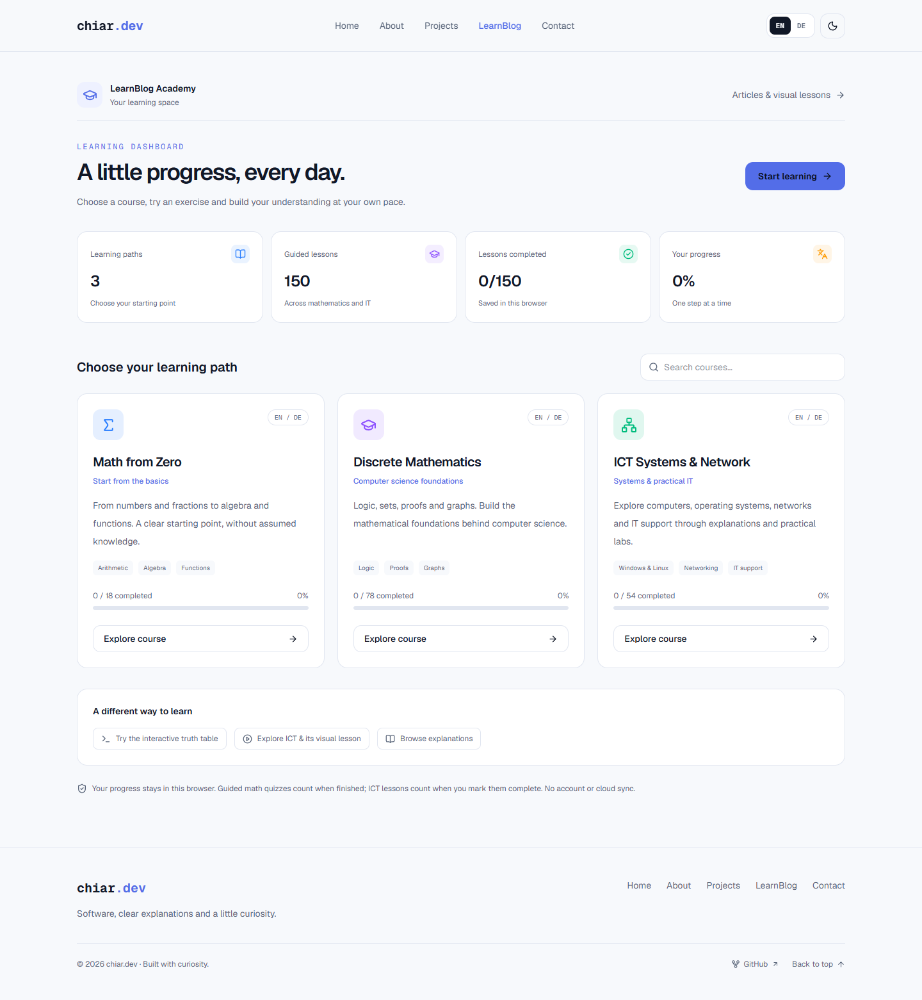

# chiar.dev

A personal portfolio and learning space by Chiar Abdi. Built around software development, IT systems and clear technical explanations.

[Repository](https://github.com/chiarAbdi/chiar-dev) · [Testing branch](https://github.com/chiarAbdi/chiar-dev/tree/testing)



## What’s here

- **Portfolio:** a short introduction, a current-work About page and a searchable project collection. Planned projects are clearly marked.
- **LearnBlog:** introductory explanations, interactive truth tables and an original animated ICT lesson.
- **Learning dashboard:** three course paths, search and browser-local completion tracking.
- **Courses:** 18 Math from Zero lessons, 78 Discrete Mathematics lessons and 54 ICT Systems & Network lessons.
- **English and German:** one language switch across navigation, page content and written lessons. The ICT video has English narration, with a German companion text available.
- **Contact:** email and GitHub links, with no account, contact database or automatic message sending.
- **Themes and accessibility:** light/dark themes, responsive layouts, keyboard controls, reduced-motion handling and opt-in background music.

## Run locally

Use Node.js 20.9 or newer and npm.

```sh
npm ci
npm run dev
```

Open [localhost:3000](http://localhost:3000). No API keys or environment file are required.

```sh
npm run lint
npx tsc --noEmit --incremental false
npm run build
npm start
```

`npm start` serves the production build. Run `npm run build` again after changes if you use that mode. For development and automatic updates, use `npm run dev`.

Google fonts are fetched by Next.js during a clean build; an internet connection may be needed for that step. The generated videos and their playback are local assets.

## Pages

| Route | Purpose |
| --- | --- |
| `/` | Introduction and links into the site |
| `/about` | Current work, approach and quiet animated background |
| `/projects` | Active applications and planned technical projects |
| `/blog` | Explanations, visual lessons and course discovery |
| `/learn` | Course dashboard and local progress |
| `/contact` | Public email and GitHub links |
| `/learn/math-from-zero` | Foundational mathematics course |
| `/learn/discrete-math/foundation` | Guided discrete mathematics course |
| `/learn/discrete-math` | Standalone introductory mathematics lessons |
| `/learn/ict-siz` | Systems and networking course |

The former `/about/preview` address redirects to `/about`. Existing lesson URLs are retained.

## Project structure

```text
src/app/                   Route entry points and metadata
src/components/pages/      Home, Projects and Contact content
src/components/about/      About content and ambient playback controls
src/components/learning/   Dashboard and LearnBlog landing page
src/components/academy/    Lessons, quizzes and video player
src/components/layout/     Shared navigation and footer
src/components/ui/         Theme and language providers
src/lib/                   Course data, translations and local-state helpers
src/assets/                Optimized portrait
public/media/              Finished video, audio, captions and posters
scripts/media/             Local media generation tools
```

Stack: Next.js App Router, React, TypeScript, Tailwind CSS, Lucide icons, Motion and next-themes. Course summaries are prepared on the server; interactive components handle searching, language selection, quizzes and local progress.

## Language and progress

The language preference uses `chiar-academy-language` in localStorage, preserving the earlier academy setting. English/German selection applies across the site and updates the document language. URLs remain the same; this is a browser preference, not a separate set of language-specific routes.

Guided math lessons count as completed after the final quiz question is submitted. ICT lessons count when marked complete. Completion does not imply mastery or certification.

Browser storage keys:

| Key | Data |
| --- | --- |
| `chiar-academy-language` | English/German preference |
| `academy-learning-progress-v1` | Completed guided math lesson IDs |
| `academy-ict-siz-v1` | Selected ICT lesson and completed indices |

Progress is local to the browser. There is no cloud sync; clearing browser storage removes it. Math notes and in-progress quiz answers are still temporary. Points, streaks and leaderboards are not implemented.

## Media

Finished media is included, so Python and FFmpeg are not needed to run the website.

To regenerate the quiet About background:

```sh
node scripts/media/render-about-background.mjs
```

This requires FFmpeg and the Sharp package installed with the project dependencies. The narrated ICT video also has an optional local Python/Kokoro workflow documented in [the lesson notes](docs/lessons/what-is-ict.md). Model files, Python environments and temporary renders are excluded from Git. The narration is synthetic; the artwork and instrumental audio are original.

## Branches and development

- `main`: the stable, reviewed version.
- `testing`: a separate starting point for changes and experiments. Work here, run the checks, then review changes before merging them into `main`.

There is no automatic deployment or CI pipeline configured. Pushing a branch does not deploy the website.

Read [AGENTS.md](AGENTS.md) before changing Next.js code, especially the installed-version documentation requirement. Update [ROADMAP.md](ROADMAP.md) and [CHANGELOG.md](CHANGELOG.md) after development tasks. [PROJECT.md](PROJECT.md) records the architecture and verified implementation history.

## Content boundaries

Learning material is independent preparation, not an official BFH or SIZ syllabus, examination bank or promise of exam readiness. Suggested study durations include independent practice. Repeated review questions and the depth of the teaching material remain areas for improvement.

The site focuses on software, IT and computer science. The About page presents current work rather than a CV or employment history.

## Contact

[Email](mailto:chiar.abdi@powercoders.org) · [GitHub](https://github.com/chiarAbdi)
